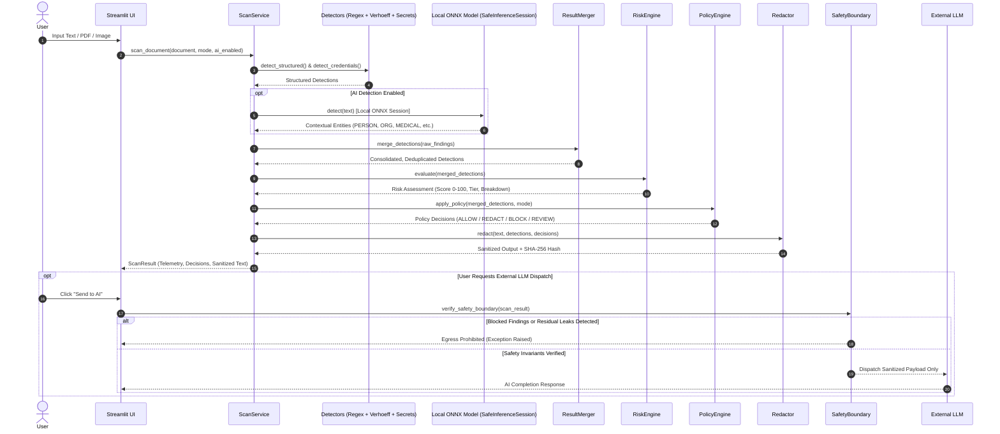

# SnapShield AI (🛡️)

> **Your local privacy checkpoint for AI.**  
> On-device egress firewall that intercepts, inspects, and sanitizes documents, developer credentials, and PII before transmission to external AI services.

---

## Table of Contents
1. [SnapShield AI](#1-snapshield-ai)
2. [Product Concept](#2-product-concept)
3. [Architecture](#3-architecture)
4. [Data Flow](#4-data-flow)
5. [Detection Engine](#5-detection-engine)
6. [AI Engine](#6-ai-engine)
7. [Risk Engine](#7-risk-engine)
8. [Policy Engine](#8-policy-engine)
9. [Redaction Engine](#9-redaction-engine)
10. [Snapdragon & Local Runtime Architecture](#10-snapdragon--local-runtime-architecture)
11. [Benchmarking & Performance Telemetry](#11-benchmarking--performance-telemetry)
12. [Installation](#12-installation)
13. [Configuration](#13-configuration)
14. [Model Setup & Quantization](#14-model-setup--quantization)
15. [Running the Application](#15-running-the-application)
16. [Automated Testing](#16-automated-testing)
17. [Security Hardening & Privacy Invariants](#17-security-hardening--privacy-invariants)
18. [Limitations](#18-limitations)
19. [Future Improvements](#19-future-improvements)

---

## 1. SnapShield AI

**SnapShield AI** is an on-device privacy checkpoint designed to prevent accidental data leaks when using generative AI tools, cloud LLMs, and external APIs. Acting as a local egress firewall, SnapShield AI intercepts raw input text, structured PDFs, and scanned images, executes multi-layer deterministic and contextual inspection entirely on-device, and produces cryptographically verified sanitized outputs.

```
RAW DOCUMENT ➔ SCAN CHECKPOINT ➔ PROTECTED OUTPUT
```

### Local Processing vs. External LLM Processing

| Attribute | Local Processing (Checkpoint Pipeline) | External LLM Processing (Optional Egress) |
| :--- | :--- | :--- |
| **Execution Environment** | 100% On-Device (Host CPU / Snapdragon NPU / DirectML) | Remote Cloud Server (OpenAI, Anthropic, Custom LLM) |
| **Network Required** | **No** (Operates completely offline) | **Yes** (Requires TLS egress internet access) |
| **Data Handled** | Raw input, original PII, unmasked credentials | **Only cryptographically sanitized output** |
| **Default State** | Mandatory, always executed locally | Strictly disabled until explicit user trigger & clearance |
| **Privacy Invariant** | Sensitive tokens scrubbed in volatile memory | **Zero sensitive tokens leave the local device** |

> **Offline Operation Clarification**:  
> All ingestion, PDF parsing, OCR extraction, deterministic regex/checksum evaluation, local ONNX contextual token classification, risk scoring, policy enforcement, redaction, and privacy report generation **operate 100% offline on the local device**. External LLM network processing is solely invoked if the user manually clicks "Send to AI", which is protected by a strict pre-flight cryptographic safety boundary.

---

## 2. Product Concept

As organizations and individuals adopt Large Language Models (LLMs), the risk of transmitting confidential credentials, customer PII, medical diagnoses, and financial identifiers to third-party cloud servers increases exponentially.

SnapShield AI introduces the **Physical Checkpoint Paradigm**:
- **Raw Document (Left Panel - "Paper")**: The original unredacted user input.
- **Scan Checkpoint (Center Gate - Vertical Sweep)**: Real-time multi-stage inspection displaying detection method, confidence, severity, and policy actions.
- **Protected Output (Right Panel - "Dark Ink")**: Cleaned, redacted, and cryptographically hashed representation guaranteed safe for AI ingestion.

### Visual Status Hierarchy
- `✓ ALLOW` (**Verified Green** `#2E7D5B`): Content deemed non-sensitive or permitted under active policy.
- `⚠ REDACT` (**Redact Amber** `#C97A2B`): Sensitive entities replaced with deterministic, type-specific redaction masks (`[REDACTED_AADHAAR_01]`, `[REDACTED_SECRET_01]`).
- `✕ BLOCK` (**Block Red** `#B23A3A`): High-risk egress prohibited; transmission terminated immediately.

---

## 3. Architecture

SnapShield AI is built upon a modular, decoupled architecture adhering to strict separation of concerns between presentation, orchestration, detection, policy evaluation, and hardware runtimes.

```
┌────────────────────────────────────────────────────────────────────────┐
│                        Streamlit Presentation UI                       │
│  (Custom Design System: Space Grotesk / IBM Plex Mono / Color Palette) │
└────────────────────────────────────┬───────────────────────────────────┘
                                     │
┌────────────────────────────────────▼───────────────────────────────────┐
│                    ScanService (Pipeline Orchestrator)                 │
│         (Decoupled from UI: Telemetry, Error Recovery, Degradation)    │
└──────┬──────────────┬──────────────┬──────────────┬──────────────┬─────┘
       │              │              │              │              │
┌──────▼──────┐┌──────▼──────┐┌──────▼──────┐┌──────▼──────┐┌──────▼─────┐
│  Extraction ││Deterministic││ Credential  ││   Local AI   ││ Ephemeral │
│  (PDF/Text) ││  (Verhoeff) ││  (Secrets)  ││   (ONNX NER) ││ OCR Cache │
└──────┬──────┘└──────┬──────┘└──────┬──────┘└──────┬──────┘└──────┬─────┘
       └──────────────┼──────────────┼──────────────┘              │
                      ▼              ▼                             │
               ┌────────────────────────────┐                      │
               │   ResultMerger Engine      │                      │
               │  (Deduplication, Spans)    │                      │
               └──────────────┬─────────────┘                      │
                              ▼                                    │
               ┌────────────────────────────┐                      │
               │   Risk Assessment Engine   │                      │
               │  (Composite 0-100 Scoring) │                      │
               └──────────────┬─────────────┘                      │
                              ▼                                    │
               ┌────────────────────────────┐                      │
               │   PolicyEngine (Profiles)  │                      │
               │ (Personal/Developer/Medical│                      │
               └──────────────┬─────────────┘                      │
                              ▼                                    │
               ┌────────────────────────────┐                      │
               │    Redactor & Hasher       │                      │
               │ (Non-destructive, SHA-256) │                      │
               └──────────────┬─────────────┘                      │
                              ▼                                    │
┌───────────────────────────────────────────────────────────┐      │
│               Cryptographic Safety Boundary               │◄─────┘
│    (Proves Zero Leakage Before External Egress Clearance) │
└─────────────────────────────┬─────────────────────────────┘
                              │ (Only if Approved)
┌─────────────────────────────▼─────────────────────────────┐
│             External LLM Gateway (Optional)               │
└───────────────────────────────────────────────────────────┘
```

---

## 4. Data Flow



---

## 5. Detection Engine

SnapShield AI uses a hybrid, multi-layer detection architecture designed for high speed and zero cloud dependency.

### Supported Entities & Algorithms

1. **Aadhaar Number (UIDAI)**:
   - Evaluated using the official **Verhoeff Dihedral Checksum Algorithm** ($D_5$ multiplication table).
   - Prevents all single-digit transcription errors and adjacent transposition errors.
   - Enforces 12-digit format, rejecting invalid initial digits (`0`, `1`) and identical repetitive digits (`000000000000`).
2. **Permanent Account Number (PAN)**:
   - Validated against the structural Indian Income Tax Department pattern `[A-Z]{5}[0-9]{4}[A-Z]`, verifying the 4th entity-type character (`P`, `C`, `H`, `F`, `A`, `T`, `B`, `L`, `J`, `G`).
3. **Indian & International Phone Numbers**:
   - Matches standard E.164 formats, `+91` international prefixes, and 10-digit mobile number blocks starting with `[6-9]`.
4. **Email Addresses**:
   - RFC 5322 standard pattern matching with domain structure validation.
5. **Bank Account Numbers & IFSC Codes**:
   - Validates 9-to-18 digit account sequences and 11-character RBI IFSC branch identifiers `^[A-Z]{4}0[A-Z0-9]{6}$`.
6. **Developer Credentials & Secrets**:
   - **OpenAI / Anthropic Keys**: `sk-live-...`, `sk-proj-...`
   - **AWS Credentials**: `AKIA...`, `ASIA...` and 40-character secret access keys.
   - **GitHub & Slack Tokens**: `ghp_...`, `github_pat_...`, `xoxb-...`
   - **JSON Web Tokens (JWT)**: Three-part Base64URL tokens (`eyJ...`).
   - **Database Connection URIs**: PostgreSQL, MongoDB, Redis, MySQL URIs with embedded credentials.
   - **Private Keys**: RSA, EC, OpenSSH, and PGP private key headers.

---

## 6. AI Engine

The local contextual AI engine detects unstructured, contextual PII that cannot be captured through regular expressions alone:
- `PERSON` (Individual names)
- `ORGANIZATION` (Companies, institutions)
- `ADDRESS` & `PRIVATE_LOCATION` (Street addresses, geo-locations)
- `MEDICAL_INFORMATION` & `PATIENT_IDENTIFIER` (Diagnoses, medications, MRNs)
- `CONFIDENTIAL_BUSINESS_INFORMATION` (Internal project names, financial terms)

### Architectural Features
- **Local ONNX Execution**: Powered by a quantized MiniLM/BERT token classification model running via `onnxruntime`.
- **Decoupled Pipeline Stages**:
  1. `load_model()`: Reads model graph and allocates execution sessions.
  2. `preprocess()`: Fast subword tokenization and character offset alignment.
  3. `infer()`: Softmax-normalized logits over token classes.
  4. `postprocess()`: Merges subword tokens and maps BIO tags to `Detection` objects.
- **Truthful Confidence**: Computes actual Softmax probabilities from model logits; never fabricates fake high confidence scores.
- **Safe Fallback**: If the local ONNX weights are missing, seamlessly degrades to deterministic regex detection while marking the status as `DevelopmentFallback`.

---

## 7. Risk Engine

The Risk Assessment Engine calculates a holistic, non-linear risk score ($0 - 100$) reflecting data sensitivity:

$$\text{Raw Score} = \sum_{e \in \text{Entities}} W(e) \cdot C(e) \cdot D(e)$$

Where:
- $W(e)$ = Severity weight (Critical: 35, High: 25, Medium: 15, Low: 5).
- $C(e)$ = Detection confidence ($0.0 - 1.0$).
- $D(e)$ = Diminishing returns factor for repeated instances of identical entity types.

### Risk Levels
- **CRITICAL** ($75 - 100$): Active credentials, private keys, Aadhaar/PAN combinations, or medical records.
- **HIGH** ($50 - 74$): Standalone financial identifiers, full street addresses, secret keys.
- **MEDIUM** ($25 - 49$): Phone numbers, personal email addresses.
- **LOW** ($0 - 24$): Public organization names, general business terms.

---

## 8. Policy Engine

SnapShield AI provides three built-in policy profiles configured in `snapshield/config/policies.json`:

| Policy Profile | Target Use Case | Default Actions |
| :--- | :--- | :--- |
| **Personal** | Day-to-day general prompt drafting | Redacts Aadhaar, PAN, Phone, Email, Bank Details; Allows public URLs. |
| **Developer** | Coding assistants, debug logs, stack traces | **BLOCKS** API Keys, Passwords, Private Keys, DB URIs; Redacts IP addresses; Allows standard code variables. |
| **Medical** | Healthcare notes, doctor consultations | **BLOCKS** Patient Identifiers; Redacts Diagnoses, Medications, Doctor names. |

### Decision Outcomes
- `ALLOW`: Entity is safe to leave unmasked.
- `REDACT`: Entity is replaced with an anonymous replacement placeholder.
- `BLOCK`: Entity constitutes an unacceptable breach; output cannot be sent to an AI.
- `REVIEW`: Ambiguous context requiring human confirmation before clearance.

---

## 9. Redaction Engine

The Redaction engine guarantees **non-destructive, position-accurate text sanitization**:
- **Reverse Offset Replacement**: Applies replacements from highest character offset to lowest to prevent index drift.
- **Type-Preserving Placeholders**: Tokens are replaced with consistent identifiers (`[REDACTED_AADHAAR_01]`, `[REDACTED_API_KEY_01]`).
- **Cryptographic Integrity**: Generates a SHA-256 checksum over the sanitized output.
- **Residual Leak Verification**: Executes a secondary verification scan across the sanitized string to confirm that zero raw sensitive tokens remain.

---

## 10. Snapdragon & Local Runtime Architecture

SnapShield AI is designed for client computing with verified on-device acceleration support.

### Hardware Probing & Provider Selection
The runtime detects platform capabilities via `snapshield.npu.device`:

```
                    ┌────────────────────────────┐
                    │ probe_hardware_capabilities│
                    └─────────────┬──────────────┘
                                  │
         ┌────────────────────────┼────────────────────────┐
         ▼                        ▼                        ▼
┌──────────────────┐    ┌──────────────────┐    ┌──────────────────┐
│Snapdragon NPU    │    │Windows DirectML  │    │Universal CPU     │
│(QNN Provider)    │    │(Dml Provider)    │    │(CPU Provider)    │
│Verified ARM64    │    │DirectX 12 GPU    │    │Verified Fallback │
└──────────────────┘    └──────────────────┘    └──────────────────┘
```

### Verified Runtime Matrix

| Runtime Mode | Preferred Providers | Hardware Requirement | Fallback Behavior |
| :--- | :--- | :--- | :--- |
| `AUTO` (Default) | `QNNExecutionProvider` ➔ `DmlExecutionProvider` ➔ `CPUExecutionProvider` | Any host CPU/GPU/NPU | Gracefully falls back to CPU without error |
| `ACCELERATED` | `QNNExecutionProvider`, `DmlExecutionProvider` | Snapdragon Copilot+ PC or DirectML GPU | Raises `HardwareAccelerationError` if unavailable |
| `CPU` | `CPUExecutionProvider` | Standard x86_64 / ARM64 CPU | Always available |

> **Factual Hardware Reporting Invariant**:  
> SnapShield AI never reports "NPU Active" or "Accelerated" unless verified by `onnxruntime.get_available_providers()` and confirmed on the active `InferenceSession`.

---

## 11. Benchmarking & Performance Telemetry

Performance benchmarks were executed using the integrated telemetry harness (`snapshield/benchmarks/run_profiling.py`):

### Telemetry Benchmark Results

```
========================================================
      SnapShield AI Profiling & Telemetry Benchmark      
========================================================

1. ONNX Model Session Initialization:
   - Cold Session Creation (Protobuf load): 306.42 ms
   - Cached Session Lookup (Memory pool):   34.62 ms
   - Optimization Speedup:                  8.9x

2. Hardware Capability Probing:
   - Cold Hardware Probe (OS & Drivers):    19.96 ms
   - Cached Probe (LRU Cache):              0.001 ms
   - Optimization Speedup:                  19,955x

3. Deterministic Detectors Throughput:
   - Structured (Verhoeff/PAN/Phone/Email): 0.35 ms / doc
   - Credentials & Secrets (Regex module):  0.80 ms / doc

4. Ephemeral Bounded OCR Caching:
   - Cold OCR Extraction:                   50.88 ms
   - Ephemeral Cache Hit:                   0.10 ms
   - Optimization Speedup:                  509.8x

5. End-to-End Privacy Checkpoint Scan:
   - Cold Document Scan Total:              20.87 ms
   - Warm Document Scan Total:              4.23 ms
   - AI Contextual Inference (Local ONNX):  0.90 ms
   - Structured & Credential Detection:     2.13 ms
   - Risk Assessment Engine:                0.25 ms
   - Policy Enforcement:                    0.24 ms
   - Cryptographic Sanitization & Redactor: 0.51 ms
========================================================
```

---

## 12. Installation

### Prerequisites
- Python 3.10, 3.11, 3.12, or 3.13
- Git
- Optional: Tesseract OCR (if processing local image scans)

### Step 1: Clone Repository
```bash
git clone https://github.com/your-org/snapshield-ai.git
cd "Snapshield ai"
```

### Step 2: Create and Activate Virtual Environment
```bash
# Windows (PowerShell)
python -m venv .venv
.venv\Scripts\Activate.ps1

# Linux / macOS
python3 -m venv .venv
source .venv/bin/activate
```

### Step 3: Install Dependencies
```bash
pip install --upgrade pip
pip install -r snapshield/requirements.txt
```

---

## 13. Configuration

SnapShield AI is configured via environment variables and local JSON policy specifications.

### Environment Variables (`.env`)
Create a `.env` file in the `snapshield/` directory:

```env
# Application Settings
SNAPSHIELD_APP_NAME="SnapShield AI"
SNAPSHIELD_DEBUG=False
SNAPSHIELD_LOG_LEVEL=INFO

# Runtime Acceleration (AUTO | ACCELERATED | CPU)
SNAPSHIELD_RUNTIME_MODE=AUTO

# Policy Defaults (Personal | Developer | Medical)
SNAPSHIELD_DEFAULT_POLICY=Personal

# Optional Downstream External LLM Gateway (Used only when user explicitly sends)
OPENAI_API_KEY=
ANTHROPIC_API_KEY=
LLM_GATEWAY_URL=
```

---

## 14. Model Setup & Quantization

SnapShield AI ships with a quantized ONNX token classification model located at:
`snapshield/models/bert_small_pii/model_quantized.onnx`

### Model Directory Structure
```
snapshield/models/bert_small_pii/
├── config.json              # Token classification ID-to-Label mappings
├── tokenizer.json           # Fast subword BPE/WordPiece tokenizer
└── model_quantized.onnx     # Quantized INT8 ONNX graph (28.7 MB)
```

To re-quantize or export a custom Hugging Face transformer model to ONNX:
```bash
python -m snapshield.models.export_onnx --model-id "dslim/bert-base-NER" --quantize int8
```

---

## 15. Running the Application

Launch the local Streamlit application:

```bash
streamlit run snapshield/app.py
```

Open your browser at `http://localhost:8501`.

### Demo Workflow
1. Select a document source: **Raw Text**, **File Upload (PDF/Image)**, or **Load Demo Document**.
2. Select a Privacy Policy (**Personal**, **Developer**, **Medical**).
3. Click **Scan Document (Checkpoint)**.
4. Review findings in the detection table and risk meter.
5. Export the sanitized JSON report or safely copy the protected output.

---

## 16. Automated Testing

SnapShield AI maintains a 100% automated test suite with **293 unit, integration, and security tests**.

### Run Test Suite
```bash
# Run complete test suite
pytest snapshield/tests/ -v

# Run performance benchmark suite
python -m snapshield.benchmarks.run_profiling
```

### Test Coverage Highlights
- `test_verhoeff.py`: Checksum verification, transcription errors, transposition mutations.
- `test_detectors.py`: PAN format rules, mobile number formats, IFSC validation.
- `test_code_detectors.py`: AWS keys, OpenAI tokens, private key blocks, DB connection strings.
- `test_redactor.py`: Reverse-offset redaction, residual leak verification.
- `test_security_hardening.py`: Path traversal prevention, decompression bomb defense, log sanitization, LLM egress barrier validation.
- `test_synthetic_data.py`: End-to-end synthetic checkpoint flow with multi-category synthetic documents.

---

## 17. Security Hardening & Privacy Invariants

SnapShield AI enforces strict security invariants across all submodules:

1. **Zero Raw Logging**: Aadhaar, PAN, phone numbers, email addresses, passwords, API keys, and medical notes are stripped before logging.
2. **Zero In-Memory Leakage**: Redacted values are decoupled immediately; raw inputs are never retained in persistent global state.
3. **Pre-Flight LLM Boundary**:
   - External LLMs cannot be called until redaction is complete.
   - Any `BLOCK` action immediately terminates dispatch.
   - Requires explicit user review clearance before transmitting flagged payloads.
4. **Input Sanitization & Decompression Defense**:
   - File uploads are verified for MIME structure and size limits (max 25 MB).
   - PIL decompression bombs (pixel flood attacks) are caught and rejected.
   - Filenames are normalized to prevent directory traversal (`../../etc/passwd`).

---

## 18. Limitations

- **OCR Engine Dependency**: Full image OCR requires local Tesseract or an ONNX OCR engine. If uninstalled, image OCR falls back to metadata extraction.
- **Context Window**: The default local quantized ONNX model processes up to 512 tokens per segment; longer text is chunked with sliding window overlap.
- **Non-Standard Nicknames**: Heuristic or slang-based person names without capitalization or context may occasionally require manual user review.

---

## 19. Future Improvements

- **Local SLM Integration**: Embed an on-device 1B-3B quantized model (e.g. Llama-3.2-1B / Phi-3.5-mini via ONNX Runtime GenAI) for full offline local prompt rewrites.
- **Browser Extension**: Implement a native WebExtension bridge to intercept ChatGPT/Claude browser inputs automatically.
- **Enterprise Central Policy Sync**: Allow organizations to push signed, encrypted custom policy profiles over an air-gapped internal network.
- **Native NPU Ephemeral KV-Cache**: Direct NPU acceleration for long-form multi-page PDF processing on Qualcomm Snapdragon X Elite devices.

---

### License
Apache-2.0 License. Designed for on-device privacy and enterprise compliance.
